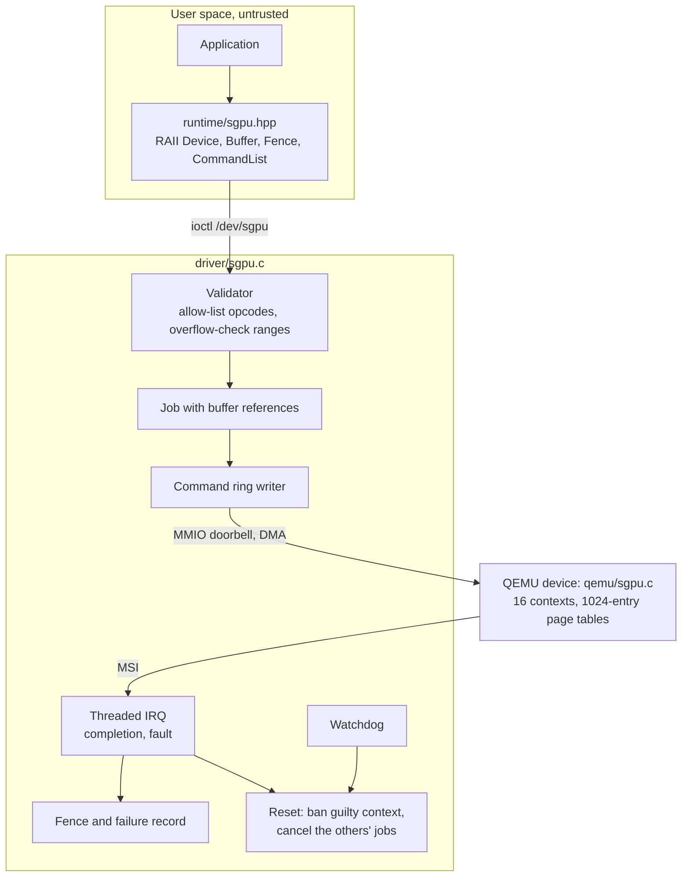

# SGPU: a GPU-style Linux driver built around hostile input

A Linux 6.12 PCI driver, a QEMU model of the device it drives, a small C++20
user-space runtime, and the test system used to break them.

SGPU is a **simulated device**. It has the moving parts of a GPU command path
(command ring, doorbell, MSI, DMA buffers, fences, per-context page tables, fault
reporting, reset) but no shader cores and no real hardware. The goal is to practise
the driver problems that do not depend on a particular chip: isolating untrusted
clients, keeping object lifetimes correct, and recovering when work goes wrong.

Results below come from logs in [`evidence/results/`](evidence/results/) and are
explained in [`docs/test-record.md`](docs/test-record.md).

## Architecture



| Path | Contents |
|---|---|
| `driver/sgpu.c` | PCI driver: contexts, buffers, submission, interrupts, watchdog, reset, debugfs, hot-unplug |
| `qemu/sgpu.c` | PCI device model for QEMU 10.2.1 |
| `include/` | Hardware registers and the user ABI |
| `runtime/sgpu.hpp` | Header-only C++20 client library |
| `tests/` | Functional, adversarial, stress and unplug tests, plus a benchmark |
| `syz/` | syzkaller syscall descriptions and seed programs |
| `scripts/` | VM test, KCSAN, mutation, benchmark and fuzzing runners |
| `tools/fuzzlog.py` | Classifies syzkaller and sanitizer logs. Has unit tests |
| `mychar/` | A smaller character driver, used as the first hardening exercise |
| `docs/` | Hardware spec, threat model, bug case study, test record, ALSA analysis |
| `evidence/` | Logs behind the published numbers and the pre-fix source of the bug |

## Design decisions

**The command stream is never trusted.** User space never writes the ring. Each
submission is copied in once, checked against an opcode allow-list, and rebuilt
by the kernel, so the device cannot see a field the kernel did not write. The
context ID is not part of the user ABI at all. See
[`docs/threat-model.md`](docs/threat-model.md) for all 13 threats and how each is
checked.

**Reference counts follow the hardware's view of memory.** The chain is
`sgpu_device <- sgpu_ctx <- sgpu_bo <- sgpu_job`. A buffer destroyed by user space
stays mapped until the last job using it completes.

**One lock order.** `remove_sem`, then `ctx->lock`, then `dev->lock`. No user copy
happens with a lock held, which is enforced by using bounce buffers.

**Faults are charged to whoever caused them.** A hang or page fault resets the
device, bans only the responsible context, and gives other contexts' in-flight
jobs `-ECANCELED`. They can resubmit on the same device.

**Removal is an ordinary event.** Unbinding the device with files still open fences
ioctls, revokes DMA memory, and leaves the open files returning `-ENODEV` until
closed.

## Bugs this process found

**A use-after-free in the close path.** The hot-unplug test showed that the last
reference to the device could be dropped while the caller still held a semaphore
embedded in it. KASAN and lockdep reported it together.
[Case study](docs/case-study-release-uaf.md), raw logs and unfixed source in
`evidence/bug-001-release-uaf/`.

**A refcount race reachable from an unprivileged process.** syzkaller found that a
submit could take a reference on a buffer whose count had already reached zero,
through a lookup table that outlived the handle it borrowed from. The unit tests
had never used an address after destroying its buffer. The fix ties the two
lifetimes together, and a deterministic regression test and a mutant now cover it.
[Case study](docs/case-study-fuzz-refcount-uaf.md), raw reports and unfixed source
in `evidence/bug-002-fuzz-refcount-uaf/`.

## Results

| Check | Result |
|---|---|
| Test suites on a KASAN, lockdep and UBSAN kernel | sgpu 292 checks, mychar 142, 0 failures, no reports, lockdep still active at the end |
| Stress, 60 s, 4 threads | 90,766 sgpu jobs and 1,939,520 mychar operations, 0 unexpected |
| Hot-unplug with work outstanding, then rescan | 5 checks, then 276 checks on the new device |
| KCSAN, 120 s per driver | 569,255 sgpu jobs, 13,188,917 mychar operations. 5 reports, all in the kernel's `osq_lock`, 0 in either driver |
| Mutation testing | 19 of 22 removed checks caught. The other 3 are equivalent to a later range check |
| syzkaller, 1 hour, 4 VMs | Before the fix: the race above, in 3 VMs. After: 30,170 programs, 0 crashes |
| Fuzzing coverage, syscall context only | `sgpu.c` 216 of 423 PCs, `mychar.c` 57 of 70 |
| `checkpatch --strict` | 0 errors, 0 warnings, 5 style checks in total |

KCSAN and fuzzing are probabilistic: a clean run does not prove absence. The
[test record](docs/test-record.md) lists the invalid runs too, including one where
this project's own harness printed PASS with lockdep switched off, and how the
harness was changed so that cannot happen again.

## Building and running

The scripts expect this layout, and everything runs without root:

```text
$HOME/work/sgpu                  this repository
$HOME/work/mychar                link to sgpu/mychar (make setup)
$HOME/work/linux-lockdep         6.12 with KASAN, KCOV, PROVE_LOCKING, UBSAN
$HOME/work/linux-kcsan           6.12 with KCSAN
$HOME/work/qemu-env/build        QEMU with sgpu added (scripts/build_qemu.sh)
$HOME/work/img/rootfs.img, id_rsa Debian or Ubuntu image with SSH key access
$HOME/work/syzkaller             syzkaller checkout
```

```bash
make setup      # link mychar where the scripts expect it
make            # driver, mychar, tests and benchmark
make check      # checkpatch and tool unit tests, no VM needed
make image      # copy modules and tests into the VM image
make vmtest     # full test suite on the debug kernel, 60 s stress
make kcsan      # data-race run on the KCSAN kernel
make mutation   # remove each safety check in turn, expect a test to fail
make fuzz       # one hour of syzkaller
```

## Known limits

- It is a simulated device. Timing and throughput numbers say little about real hardware.
- The VM ran under TCG without KVM, on a debug kernel. Execution counts are low compared with a KVM setup.
- There is no IOMMU in the test setup and a malicious device is out of scope.
- No scheduler: submissions run in arrival order, with no fairness between contexts.
- The ALSA study in `docs/` is a source-level reading of a public fix. The bug was not reproduced.

Built with Claude Code as a coding agent. I set the direction, reviewed its output,
and verified results in a test VM.
